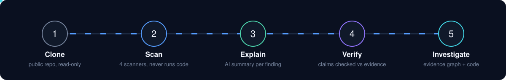
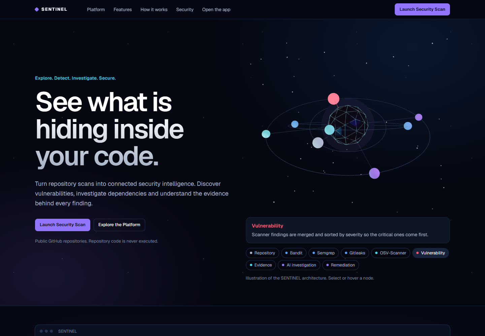
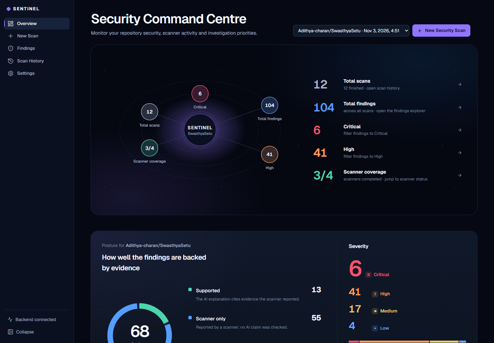
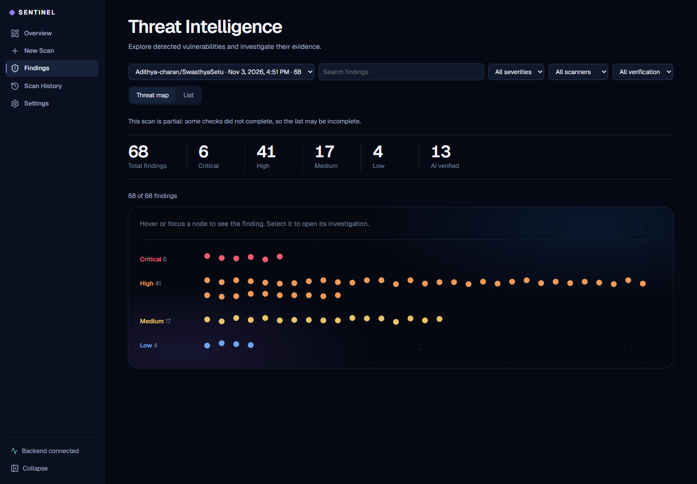
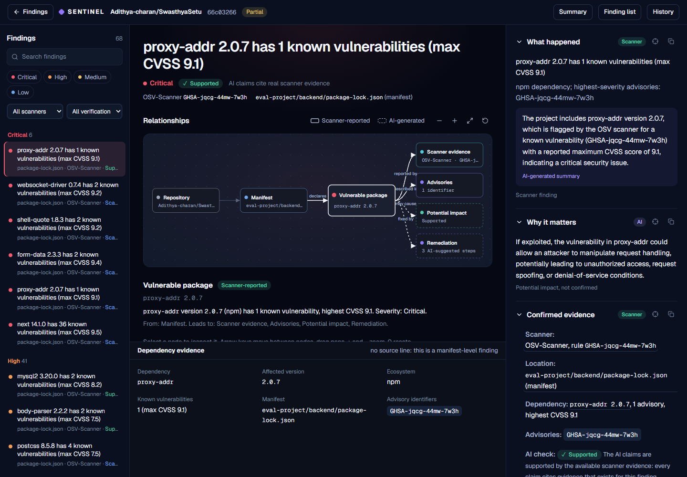
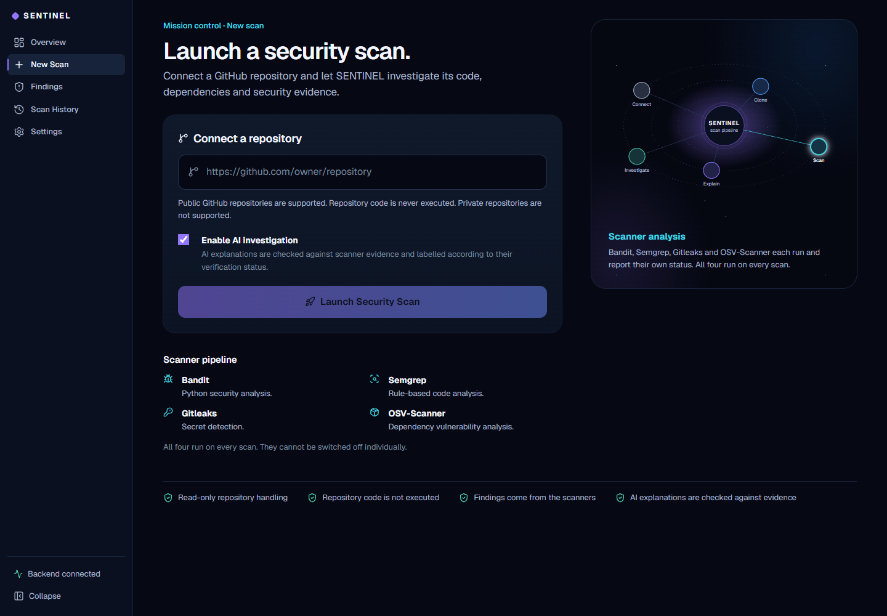

<p align="center">
  
</p>

<p align="center">
  
  
  
  
  
  
</p>

<p align="center">
  <b>SENTINEL turns repository scans into connected security intelligence.</b><br>
  Scan a public GitHub repository, then investigate every finding with evidence you can verify.
</p>

---

## Overview

SENTINEL is an AI-assisted code auditor. You give it a public GitHub repository URL; it runs four
established security scanners, asks an LLM to explain each finding, and then **checks the AI's claims
against what the scanners actually reported**. Every finding is labelled with how well it is backed by
evidence, so you can tell what is confirmed from what is only a guess.

> Repository code is **never executed**. Only static analysis is performed.

<p align="center">
  
</p>

## Features

| | |
|---|---|
| **Four scanners** | [Bandit](https://github.com/PyCQA/bandit) (Python), [Semgrep](https://semgrep.dev) (rules), [Gitleaks](https://github.com/gitleaks/gitleaks) (secrets) and [OSV-Scanner](https://google.github.io/osv-scanner/) (dependencies). Each reports its own status, so a failed scanner is never hidden. |
| **Evidence verification** | Each AI explanation is marked **Supported**, **Scanner confirmed**, **Uncertain** or **Unsupported** after comparison with scanner output. |
| **Security Command Centre** | Orbital overview of scans, findings, severity and scanner coverage. Every element is clickable and opens the matching filtered view. |
| **Threat Intelligence** | Findings as a threat map or a sortable list, filterable by severity, scanner, verification state and text. |
| **Investigation workspace** | An evidence graph (repository, file, vulnerability, evidence, advisory, impact, fix), a source viewer and an AI panel. Selecting evidence focuses the matching graph node. |
| **Interactive 3D landing** | A lazy-loaded three.js security core, with a 2D fallback when WebGL is unavailable and support for reduced motion. |
| **Honest by design** | No invented progress percentages, no mock data. Scan status comes straight from the server. |

## Screenshots

<table>
  <tr>
    <td width="50%"><br><sub>Landing page with the 3D security core</sub></td>
    <td width="50%"><br><sub>Security Command Centre</sub></td>
  </tr>
  <tr>
    <td width="50%"><br><sub>Threat Intelligence</sub></td>
    <td width="50%"><br><sub>Investigation workspace</sub></td>
  </tr>
  <tr>
    <td colspan="2"><br><sub>Launch a security scan</sub></td>
  </tr>
</table>

## Architecture

```
React 19 + Vite  ──►  FastAPI  ──►  Scanners (Bandit · Semgrep · Gitleaks · OSV-Scanner)
   (frontend)           │    └────►  Groq LLM (optional explanations)
                        └─────────►  PostgreSQL (Neon) via SQLAlchemy + Alembic
```

```
.
├── backend/            FastAPI app, scanner runners, AI step, migrations, tests
│   ├── app/
│   ├── migrations/
│   └── tests/
├── frontend/           React + Vite single-page app (plain JavaScript)
│   └── src/
├── docs/               README assets and screenshots
└── README.md
```

## Getting started

### Prerequisites

- Python 3.11+ and Node.js 20+
- A PostgreSQL database (a free [Neon](https://neon.tech) project works well)
- Optional: a [Groq](https://groq.com) API key for AI explanations
- Optional: `gitleaks` and `osv-scanner` on your `PATH` (Bandit and Semgrep install with `pip`). A missing scanner is reported as unavailable instead of failing the scan.

### 1. Backend

```bash
cd backend
python -m venv .venv
.venv\Scripts\activate          # macOS/Linux: source .venv/bin/activate
pip install -r requirements.txt
cp .env.example .env            # then fill in the values
alembic upgrade head
uvicorn app.main:app --port 8000
```

Environment variables:

| Variable | Purpose |
|---|---|
| `DATABASE_URL` | PostgreSQL connection string (required) |
| `DATABASE_URL_UNPOOLED` | Direct connection used for migrations (optional) |
| `GROQ_API_KEY` | Enables AI explanations (optional) |
| `GROQ_MODEL` | Model name, default `openai/gpt-oss-120b` |
| `CORS_ORIGINS` | Allowed frontend origin, default `http://localhost:5173` |

### 2. Frontend

```bash
cd frontend
npm install
npm run dev
```

Open <http://localhost:5173>. The dev server proxies `/api` to `http://127.0.0.1:8000`.

### 3. Tests

```bash
cd backend
pytest
```

## API

| Method | Endpoint | Description |
|---|---|---|
| `GET` | `/api/health` | API and database status |
| `POST` | `/api/scans` | Start a scan for a GitHub repository URL |
| `GET` | `/api/scans` | List scans |
| `GET` | `/api/scans/{id}` | Scan status and per-scanner results |
| `GET` | `/api/scans/{id}/findings` | Findings for a scan |
| `GET` | `/api/findings/{id}` | One finding with evidence and AI analysis |

## Security notes

- Only public `https://github.com/<owner>/<repo>` URLs are accepted.
- Repository code is cloned and analysed statically; it is never built or run.
- Secrets live in `.env` files that are git-ignored. Never commit them.
- AI output is treated as a claim to be verified, not as a source of truth.

## Roadmap

- Private repository support
- ZIP upload
- Exportable reports

## License

No license has been chosen yet. All rights reserved by the author until one is added.
